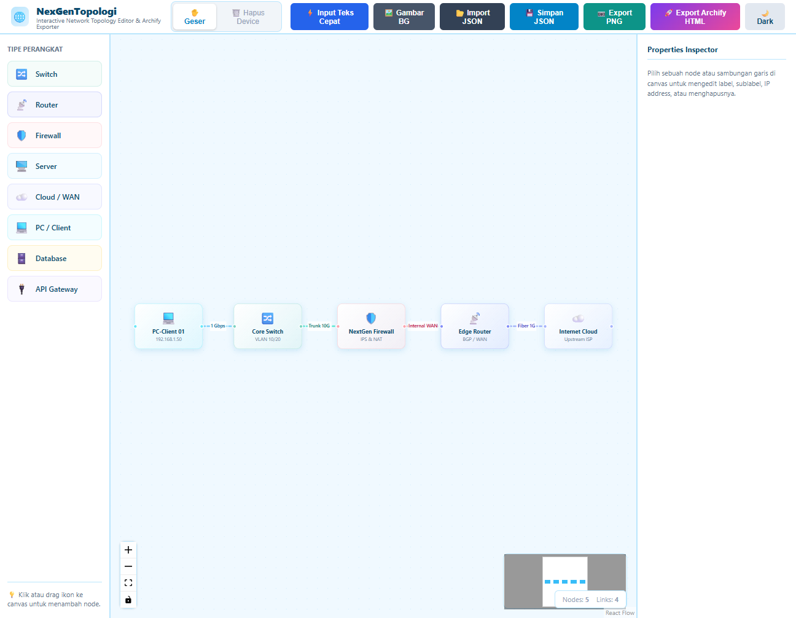
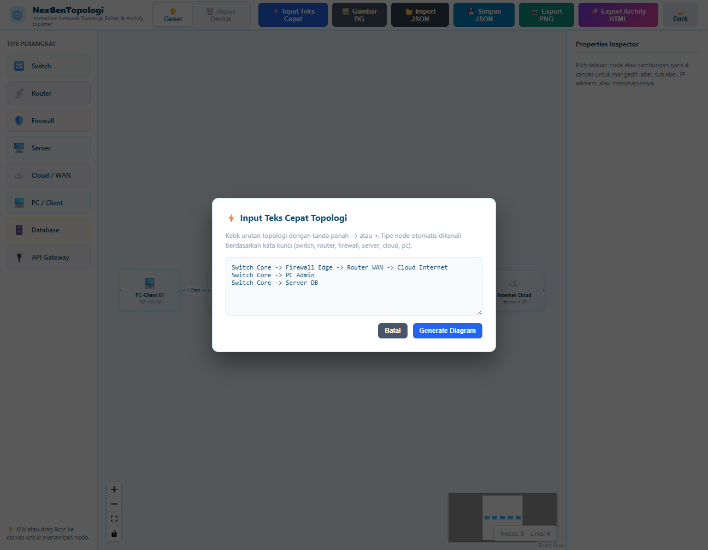

# Tutorial NetTopo

Editor topologi jaringan dengan tema biru awan pastel.



## 1. Jalankan

Butuh Node.js 18+.

```bash
npm install
npm run build
PORT=8933 node server.js
```

Buka `http://localhost:8933`.

> Port 8932 sering dipakai proyek lain (contoh: netmon-collector). Pakai `PORT` berbeda kalau bentrok.

## 2. Tambah device

- Klik ikon di sidebar kiri (Router, Switch, PC, Server, Firewall, Cloud, API, Database), lalu geser ke canvas.
- Atau klik **⚡ Input Teks Cepat** di header untuk menulis banyak device sekaligus.



## 3. Sambung kabel

- Setiap device punya dua titik: **kiri** (masuk) dan **kanan** (keluar).
- Tarik dari titik kanan satu device ke titik kiri device lain.
- Kabel selalu lurus dan keluar-masuk dari samping.

## 4. Edit

- Klik device untuk memilih, lalu ubah label dan deskripsi di panel kanan.
- Geser device dengan mouse.
- Hapus: pilih device atau kabel, lalu tekan `Delete`, atau pakai mode **🗑️ Hapus Device**.

## 5. Tema

- Default terang (biru awan). Klik toggle di header untuk mode gelap.

## 6. Simpan dan bagikan

| Tombol | Fungsi |
| --- | --- |
| 💾 Simpan JSON | Simpan diagram ke file JSON |
| 📂 Import JSON | Buka lagi file JSON |
| 📷 Export PNG | Gambar diagram sebagai PNG |
| 🚀 Export Archify HTML | File HTML mandiri |
| 🖼️ Gambar BG | Pasang gambar latar |

## Catatan

- Export Archify HTML belum diuji ulang end-to-end.
- Launcher `start-server.bat` masih memakai port 8932. Ubah ke 8933 jika ingin jalan berdampingan dengan netmon-collector.
